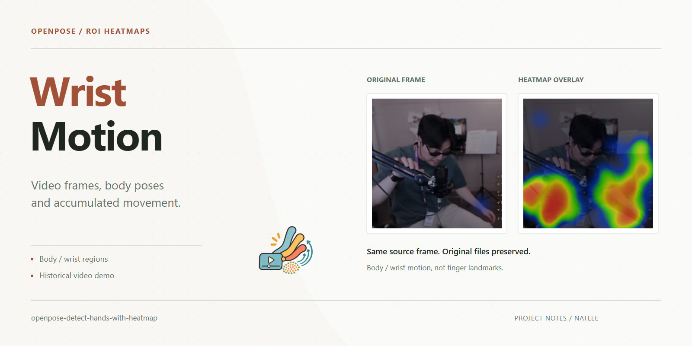
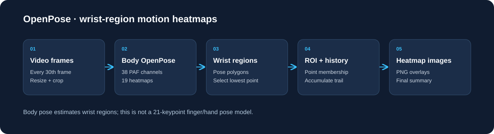
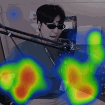

# OpenPose Wrist Motion Heatmaps



Accumulate body-pose wrist regions from a video and draw their motion as heatmaps.
The historical repository name says “hands”, but the network is the body OpenPose
model with **38 part-affinity channels and 19 heatmap channels**. It does not infer
21 finger landmarks or fine hand articulation.

## Architecture



The demo samples every 30th frame, scales by 0.3, crops to 215 × 215, and runs
two inference scales (0.5 and 1). Its six-stage VGG-based network yields body
pose candidates; the renderer returns arm/wrist polygons. The demo selects the
lowest point of each polygon, applies the configured vertical offset and tests
ROI membership. Historical points are then drawn over sampled frames.

ROI masks use a union, so overlapping regions do not wrap 8-bit pixel values or
darken the image. Masks rebuild when the frame size changes. Point tests retain
the existing behavior: inside **any** polygon, with boundary points excluded.

## Quick start

Requires Docker with Compose v2. Download the original
[OpenPose Keras weights](https://huggingface.co/NatLee/openpose-keras-model)
to `model/weights.h5`, and put your video at `data/test.mp4`.

```bash
docker compose up --build
```

Outputs appear in `tmp/`: sampled PNG overlays and `00000.heatmap.png`, the
summary drawn on the first processed frame. Stop with `docker compose down`.
The demo is file-based and does not start a web service. A missing/unreadable
video or a video with no decoded frames now reports an explicit error.

The CPU image uses Python 3.12, TensorFlow 2.21 and `tf-keras` 2.21. Public Keras
2 layer imports preserve the original architecture and HDF5 loader. GPU execution
and the original pretrained weights have not been revalidated.

## Configuration and files

| File | Responsibility |
| --- | --- |
| `src/main.py` | Video path, sampling, resize/crop, ROI polygons and heatmap output |
| `src/openpose/model.py` | Six-stage body network |
| `src/openpose/prediction.py` | Multiscale prediction and pose assembly |
| `src/utils/ROIs.py` | Polygon membership and frame masks |
| `src/utils/draw_heat.py` | Brightness adjustment and HeatMappy rendering |

ROI coordinates refer to the resized/cropped frame. Review the crop and polygon
coordinates together for a different camera; the sample values do not describe
every scene. The all-video summary uses the original demo's unshifted points.

## Historical example and references



The historical demo frames come from
[the credited source video](https://www.youtube.com/watch?v=u6w9HYmQMgQ).
The new cover is conceptual artwork and does not reuse those frames.
The heatmap implementation derives from
[HeatMappy](https://github.com/LumenResearch/heatmappy/tree/master/heatmappy),
and the pose implementation from
[Open-Pose-Keras](https://github.com/cchamber/Open-Pose-Keras).
See [LICENSE](LICENSE) for the repository's AFL-3.0 license and review upstream
code/model terms separately.

## Development and verification

Use Python 3.12 in an isolated environment:

```bash
python -m pip install -r requirements-dev.txt
python -m pytest -q
```

The local CPU regression suite passes 3 tests. Tests build the actual body network and check output channels, overlapping ROI intensity, frame resizing and point/boundary membership. They do not measure pose accuracy or run an end-to-end pretrained video inference.
GitHub Actions repeats the tests on Python 3.12. The cover is conceptual artwork;
it does not show measured model results.

## Contributor

<!-- ALL-CONTRIBUTORS-LIST:START - Do not remove or modify this section -->
<!-- prettier-ignore-start -->
<!-- markdownlint-disable -->
<table>
  <tbody>
    <tr>
      <td align="center"><a href="https://github.com/NatLee"><br /><sub><b>Nat Lee</b></sub></a></td>
    </tr>
  </tbody>
</table>

<!-- markdownlint-restore -->
<!-- prettier-ignore-end -->

<!-- ALL-CONTRIBUTORS-LIST:END -->
